# ambientCG: Terrazzo materials

**21 assets from [ambientCG](https://ambientcg.com), dedicated to the public domain under [CC0](https://docs.ambientcg.com/license/).** Use them in any game, free or paid, and change them however you like; no credit is needed.

PBR materials as 1K and 2K JPG maps (colour, normal GL and DX, roughness, AO, displacement), one folder per resolution. 505.2 MB in all.

This is a copy kept by [zuujis-cc0](https://github.com/zuujis-cc0) so game makers can take single files from GitHub. It is not made by or affiliated with ambientCG: the originals, often in more formats and higher resolutions, are on [ambientcg.com](https://ambientcg.com). If they help you, consider [supporting ambientCG](https://www.patreon.com/ambientCG).

Every file is listed in [MANIFEST.tsv](MANIFEST.tsv) with its size and SHA-256. More free assets: [the Zuujis collection](https://github.com/zuujis-cc0/free-game-assets#readme).

| | | | |
| :-: | :-: | :-: | :-: |
| <a href="Terrazzo001">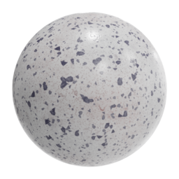</a> <b><a href="Terrazzo001">Terrazzo 001</a></b> by ambientCG · <a href="https://ambientcg.com/a/Terrazzo001">source</a> | <a href="Terrazzo002">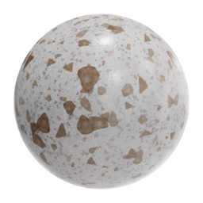</a> <b><a href="Terrazzo002">Terrazzo 002</a></b> by ambientCG · <a href="https://ambientcg.com/a/Terrazzo002">source</a> | <a href="Terrazzo003">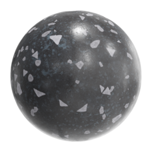</a> <b><a href="Terrazzo003">Terrazzo 003</a></b> by ambientCG · <a href="https://ambientcg.com/a/Terrazzo003">source</a> | <a href="Terrazzo004">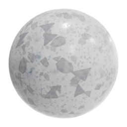</a> <b><a href="Terrazzo004">Terrazzo 004</a></b> by ambientCG · <a href="https://ambientcg.com/a/Terrazzo004">source</a> |
| <a href="Terrazzo005">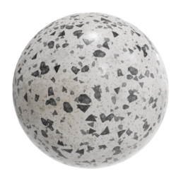</a> <b><a href="Terrazzo005">Terrazzo 005</a></b> by ambientCG · <a href="https://ambientcg.com/a/Terrazzo005">source</a> | <a href="Terrazzo006">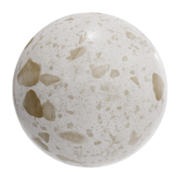</a> <b><a href="Terrazzo006">Terrazzo 006</a></b> by ambientCG · <a href="https://ambientcg.com/a/Terrazzo006">source</a> | <a href="Terrazzo007">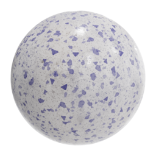</a> <b><a href="Terrazzo007">Terrazzo 007</a></b> by ambientCG · <a href="https://ambientcg.com/a/Terrazzo007">source</a> | <a href="Terrazzo008">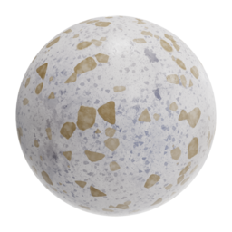</a> <b><a href="Terrazzo008">Terrazzo 008</a></b> by ambientCG · <a href="https://ambientcg.com/a/Terrazzo008">source</a> |
| <a href="Terrazzo009">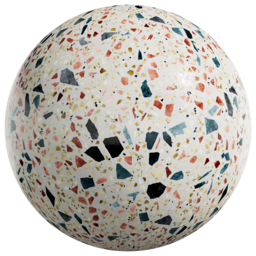</a> <b><a href="Terrazzo009">Terrazzo 009</a></b> by ambientCG · <a href="https://ambientcg.com/a/Terrazzo009">source</a> | <a href="Terrazzo010">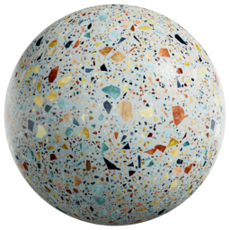</a> <b><a href="Terrazzo010">Terrazzo 010</a></b> by ambientCG · <a href="https://ambientcg.com/a/Terrazzo010">source</a> | <a href="Terrazzo011">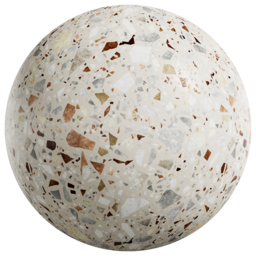</a> <b><a href="Terrazzo011">Terrazzo 011</a></b> by ambientCG · <a href="https://ambientcg.com/a/Terrazzo011">source</a> | <a href="Terrazzo012">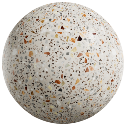</a> <b><a href="Terrazzo012">Terrazzo 012</a></b> by ambientCG · <a href="https://ambientcg.com/a/Terrazzo012">source</a> |
| <a href="Terrazzo013">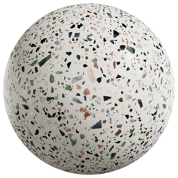</a> <b><a href="Terrazzo013">Terrazzo 013</a></b> by ambientCG · <a href="https://ambientcg.com/a/Terrazzo013">source</a> | <a href="Terrazzo014">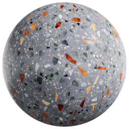</a> <b><a href="Terrazzo014">Terrazzo 014</a></b> by ambientCG · <a href="https://ambientcg.com/a/Terrazzo014">source</a> | <a href="Terrazzo015">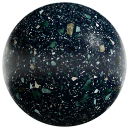</a> <b><a href="Terrazzo015">Terrazzo 015</a></b> by ambientCG · <a href="https://ambientcg.com/a/Terrazzo015">source</a> | <a href="Terrazzo016">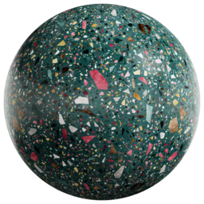</a> <b><a href="Terrazzo016">Terrazzo 016</a></b> by ambientCG · <a href="https://ambientcg.com/a/Terrazzo016">source</a> |
| <a href="Terrazzo017">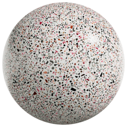</a> <b><a href="Terrazzo017">Terrazzo 017</a></b> by ambientCG · <a href="https://ambientcg.com/a/Terrazzo017">source</a> | <a href="Terrazzo018">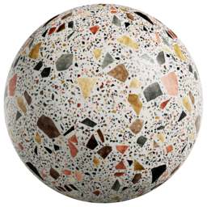</a> <b><a href="Terrazzo018">Terrazzo 018</a></b> by ambientCG · <a href="https://ambientcg.com/a/Terrazzo018">source</a> | <a href="Terrazzo019L">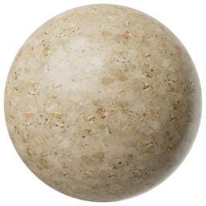</a> <b><a href="Terrazzo019L">Terrazzo 019 L</a></b> by ambientCG · <a href="https://ambientcg.com/a/Terrazzo019L">source</a> | <a href="Terrazzo019M">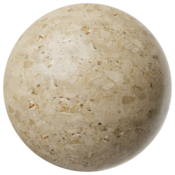</a> <b><a href="Terrazzo019M">Terrazzo 019 M</a></b> by ambientCG · <a href="https://ambientcg.com/a/Terrazzo019M">source</a> |
| <a href="Terrazzo019S">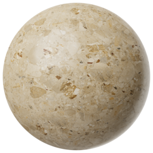</a> <b><a href="Terrazzo019S">Terrazzo 019 S</a></b> by ambientCG · <a href="https://ambientcg.com/a/Terrazzo019S">source</a> |  |  |  |

---

Kept up to date by this repository's own [update workflow](.github/workflows/update.yml), with code and plan from [cc0-mirror](https://github.com/zuujis-cc0/cc0-mirror). Something wrong? [Open an issue there](https://github.com/zuujis-cc0/cc0-mirror/issues/new) or use the [private report form](https://games.zuujis.com/report).
